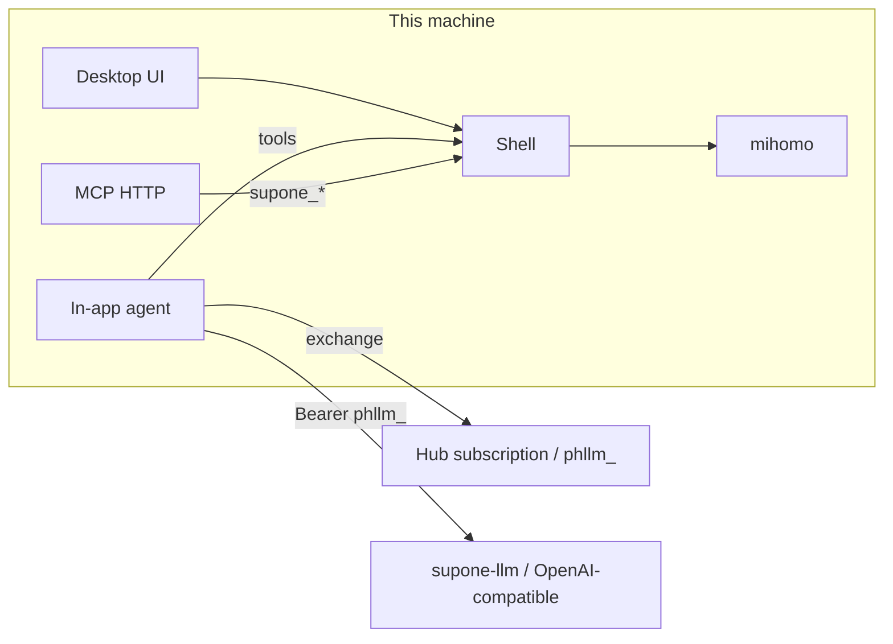

# Supone Tunnel

**Desktop shell for [mihomo](https://github.com/MetaCubeX/mihomo)** — subscriptions, TUN / system proxy, and an in-app agent that can **change your local proxy** through tools (not a chat-only brain).

Also exposes the same control surface as **MCP** for external agents (PI, etc.).

[中文说明](#中文)

[](https://github.com/passionke/supone-tunnel/actions/workflows/release.yml)
[](https://github.com/passionke/supone-tunnel/releases)

## Why

Clash / mihomo clients usually stop at “pick a node in the UI”. Supone Tunnel treats the shell as the **only writer** of local mihomo state:

- UI and agent share one `Shell` API (no parallel YAML editors)
- In-app chat runs a **local tool loop** (select proxy, rules, DNS, TUN, …)
- External agents talk to the same tools over MCP



## Features

- Import / refresh Clash subscriptions; local overrides survive refresh
- Start / stop mihomo; rule / global / direct modes
- Select proxy group members; upsert local proxy groups
- TUN + system proxy; `route-exclude-address` for stacked VPN / node IPs
- Prepend rules & DNS overrides (not wiped by subscription refresh)
- Diagnose: explain route, probe URL via mixed port, connections, net overview
- In-app multi-conversation chat with tool calls
- MCP (`streamable HTTP` + Bearer) — see [`docs/mcp-tools.md`](docs/mcp-tools.md)

## Install

Download from **[Releases](https://github.com/passionke/supone-tunnel/releases)** (CI packages only on formal `v*` tags):

| Platform | Artifact |
|----------|----------|
| Windows x64 | `Supone.Tunnel_*_x64-setup.exe` (NSIS) |
| macOS Apple Silicon | `Supone.Tunnel_*_macos-aarch64.app.zip` |
| Linux x64 (portable) | `*.AppImage` |
| Linux x64 (Debian/Ubuntu) | `*.deb` |

> Intel Mac：CI 不打 x64。本机 Intel 用 `REGION=else ./scripts/build.sh`。

macOS: unzip, drag `Supone Tunnel.app` to `/Applications`. Unsigned builds may need **Right-click → Open** the first time (or `xattr -dr com.apple.quarantine`).

Linux AppImage: `chmod +x *.AppImage && ./Supone*.AppImage`

## Chat / credentials

In-app chat does **not** ask you for a raw API key in the happy path:

1. Import an authorized subscription URL: `https://phub.supone.vip/clash/<token>`
2. The shell exchanges that token with the Hub for a short-lived `phllm_` call token
3. Completions go to the Hub-issued `base_url` (OpenAI-compatible, tools allowed)
4. Tool calls run **on this machine** via `Shell`

Without an authorized Hub subscription, chat stays locked; MCP / UI control of mihomo still work once configured.

## MCP (external agents)

Enable MCP in Settings (`mcpEnabled`, bind, token). Example for a local HTTP MCP client:

```json
{
  "mcpServers": {
    "supone-tunnel": {
      "type": "http",
      "url": "http://127.0.0.1:18765/mcp",
      "headers": {
        "Authorization": "Bearer <mcpToken>"
      }
    }
  }
}
```

Full tool catalog and routing tips: [`docs/mcp-tools.md`](docs/mcp-tools.md).

## Build from source

Requirements: Node 22+, Rust stable, platform bundler deps ([Tauri 2 prerequisites](https://v2.tauri.app/start/prerequisites/)).

```bash
git clone https://github.com/passionke/supone-tunnel.git
cd supone-tunnel
npm ci && npm ci --prefix ui
```

**Region mirrors** (single switch — do not invent a second path):

| `REGION` | Effect |
|----------|--------|
| `else` (default) | crates.io / default npm / Debian upstream |
| `china` | rsproxy + npmmirror (and China apt mirrors in Docker recipes elsewhere) |

```bash
# macOS .app → /Applications/Supone Tunnel.app
REGION=else ./scripts/build.sh
# or in China:
REGION=china ./scripts/build.sh

# Windows NSIS (on Windows or CI)
REGION=else npm run build -- --bundles nsis
```

Dev:

```bash
REGION=else npm run dev
```

## Repository layout

```
ui/                 React (Vite) frontend
src-tauri/          Rust / Tauri 2 shell, mihomo control, agent, MCP
scripts/            build / dev helpers
docs/mcp-tools.md   MCP + tool contract
.github/workflows/  GitHub Release package only on v* tags
```

## Versioning & releases

- Day-to-day: PR → merge `main` (no package / no Release)
- Semver in `package.json` / `src-tauri/tauri.conf.json` / `src-tauri/Cargo.toml`
- Formal release: on `main`, tag `vX.Y.Z` → CI builds **Windows + macOS arm64 + Linux (AppImage/deb)** → [GitHub Release](https://github.com/passionke/supone-tunnel/releases)

Local macOS only:

```bash
REGION=else ./scripts/build.sh   # → /Applications/Supone Tunnel.app
```

## Contributing

- Prefer small PRs that stay inside module boundaries (`Shell` owns mihomo writes; UI/agent/MCP call into it)
- Land changes by merging to `main`; do not push ad-hoc branches to trigger packaging
- Do not add a second “just for this case” config or deploy path without discussion
- New source files: set file-header `Author: kejiqing` (not git commit identity)
- No real Hub subscription URLs/tokens in tree; `gitleaks` (`.gitleaks.toml`) via pre-commit + CI on `main`/PR

## License

[Apache License 2.0](LICENSE) © kejiqing  
See also [`NOTICE`](NOTICE).

---

## 中文

**Supone Tunnel** 是本机 **mihomo 壳**：订阅、TUN / 系统代理，以及能**真正改本机代理**的对话工具环（不是只读嘴炮）。同一套能力也对外部 agent 暴露为 **MCP**。

- 安装：见 [Releases](https://github.com/passionke/supone-tunnel/releases)（仅 `v*` tag 打包：Windows / macOS arm64 / Linux AppImage+deb；日常合并 `main`；本机 mac 可用 `REGION=china|else ./scripts/build.sh`）
- 对话：导入 `https://phub.supone.vip/clash/<token>` → Hub 换 `phllm_` → OpenAI 兼容口带 tools → **本机执行**
- MCP 契约：[`docs/mcp-tools.md`](docs/mcp-tools.md)
- 构建镜像开关：环境变量 `REGION=china` 或 `else`（唯一分叉）

作者：kejiqing · 协议：Apache-2.0
